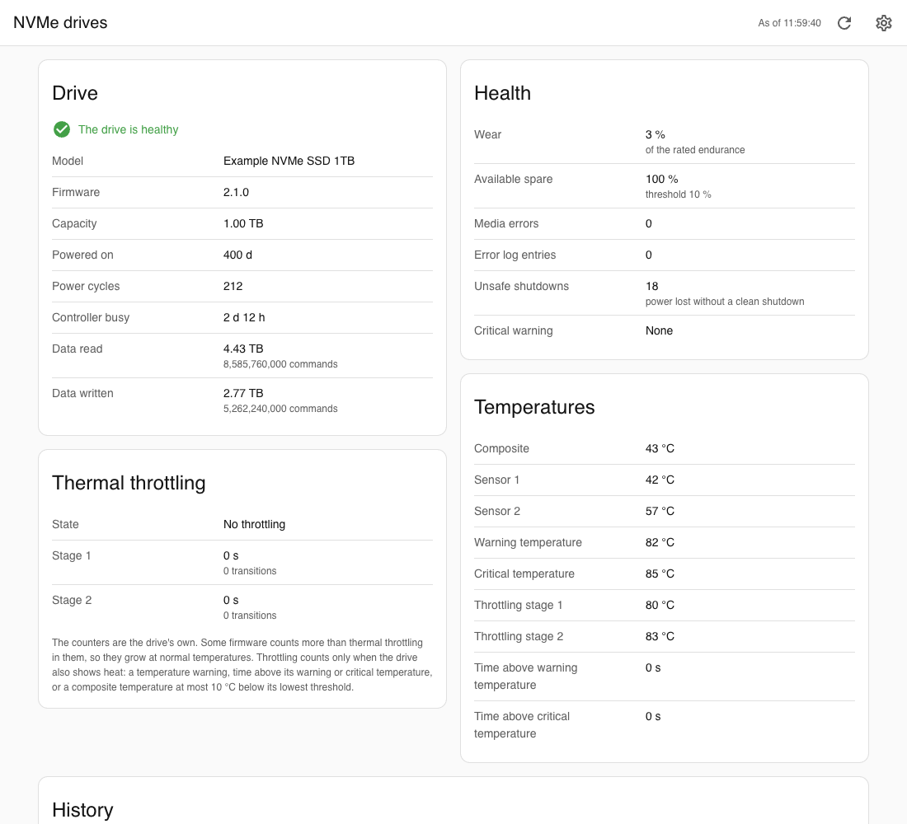
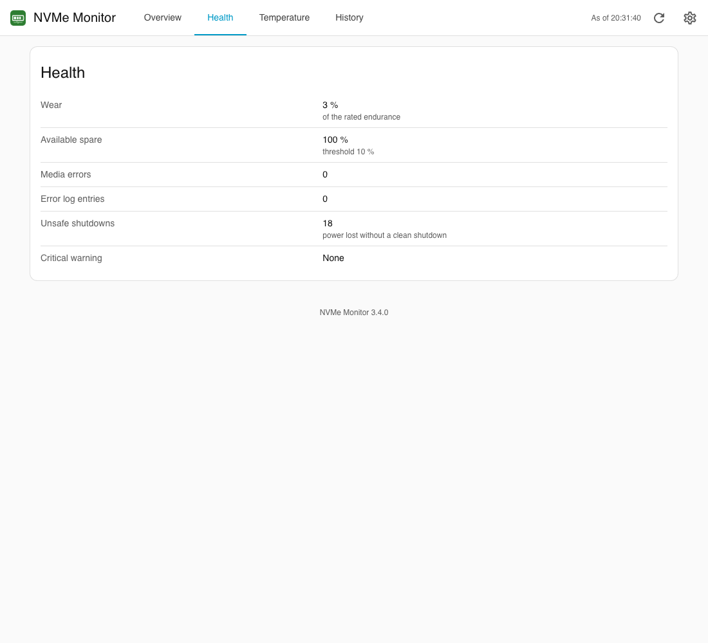
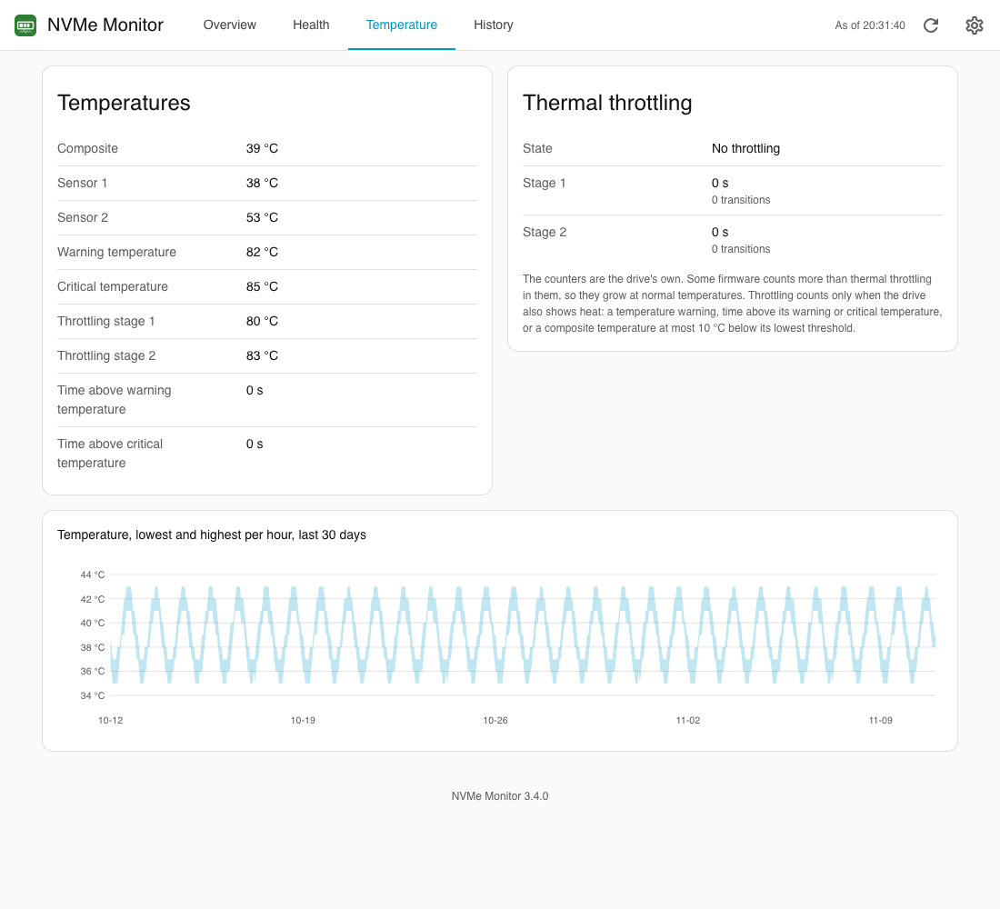
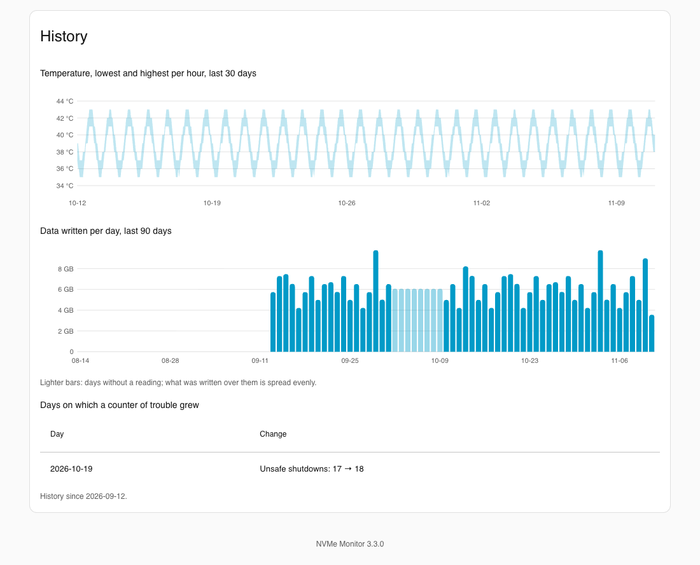
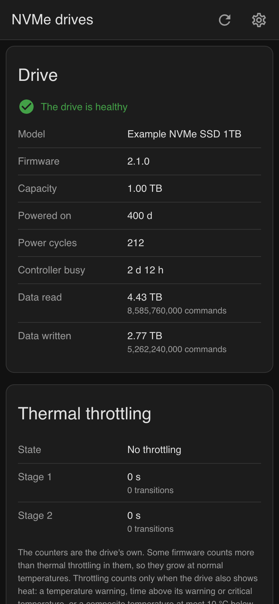
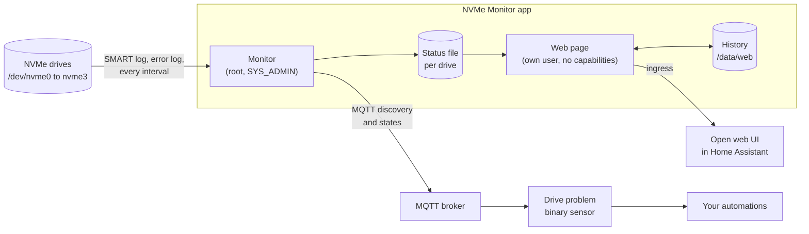

# NVMe Monitor app for Home Assistant

[](LICENSE)


A Home Assistant app that reads the SMART log of the host's NVMe drives and shows their health, wear, temperatures, thermal throttling and history on a web page in Home Assistant. For automations it publishes one **Drive problem** sensor per drive through MQTT discovery, which turns on when a drive needs attention and names the reasons. It only reads: nothing is written to the drives or the host. Crashes of host programs are covered by the [Crash Guard](https://github.com/n-schilling/ha-app-crash-guard) app.

Requires Home Assistant 2026.11 or later.

## Screenshots

The data in these pictures is made up for these pictures.











## Overview



The monitor reads every drive once per interval, judges whether it needs attention and sends that to Home Assistant; the whole SMART log goes to the web page, which keeps its own history. The [documentation](nvme_monitor/DOCS.md) has the details, with the flow of a reading and the states of the sensor.

## Installation

1. Add the repository to your Home Assistant instance:

   [](https://my.home-assistant.io/redirect/supervisor_add_addon_repository/?repository_url=https%3A%2F%2Fgithub.com%2Fn-schilling%2Fha-app-nvme-monitor)

   Or add it manually: **Settings → Apps → Install app → ⋮ → Repositories**, then paste:

   ```text
   https://github.com/n-schilling/ha-app-nvme-monitor
   ```

2. Find **NVMe Monitor** in the list of apps, install it and start it.
3. Open the web page with **Open web UI** on the app's page.

See [the documentation](nvme_monitor/DOCS.md) for the options, the web page, the sensor, an example automation and troubleshooting. Changes are listed in the [changelog](nvme_monitor/CHANGELOG.md).

## Development

The monitor is a bash script, [`monitor/run`](nvme_monitor/rootfs/etc/s6-overlay/s6-rc.d/monitor/run), the web page a Python program without third-party packages, [`nvme_web.py`](nvme_monitor/rootfs/usr/local/lib/nvme_web.py); the image installs only Debian packages. The page's look comes from the stylesheet shared by these apps, [`ha.css`](nvme_monitor/rootfs/usr/local/share/ha-app/ha.css), and its language from the script shared by them, [`ha-lang.js`](nvme_monitor/rootfs/usr/local/share/ha-app/ha-lang.js); both stay identical in every app.

```bash
scripts/check.sh
```

`scripts/check.sh` runs what CI runs (changelog, shellcheck, ruff, the image built for this machine with the tests of the monitor, the image and the web page, the test against a real MQTT broker and the Page check; `--no-docker` skips everything that needs Docker). It needs bash, Python 3 and Docker; shellcheck and ruff come from Docker and `uvx` when they are not installed. The Page check and the screenshots are one script, `scripts/screenshots.py` (see its header for the setup): it starts the built image with made-up data in a throwaway container, opens the page through a stand-in for Home Assistant's ingress with a headless browser, checks the header every app page shares, the version line, console and content security policy, light, dark and phone width, and writes the screenshots to `docs/screenshots`. The page check is not part of CI: run `scripts/check.sh` before a release that changes the page.

Releases: work on `dev`, raise `version` in `nvme_monitor/config.yaml` and add its section to the changelog. CI runs on `dev` (amd64 and aarch64 each on a runner of its own kind); once it is green, push that commit to `main`. CI does not run again there: the release workflow checks that CI passed for the commit, then tags the version and publishes the release with that section.

## Support

Questions, bugs and ideas: [open an issue](https://github.com/n-schilling/ha-app-nvme-monitor/issues/new/choose) in this repository. Security problems: see [SECURITY.md](SECURITY.md).

## License

[Apache License 2.0](LICENSE)
