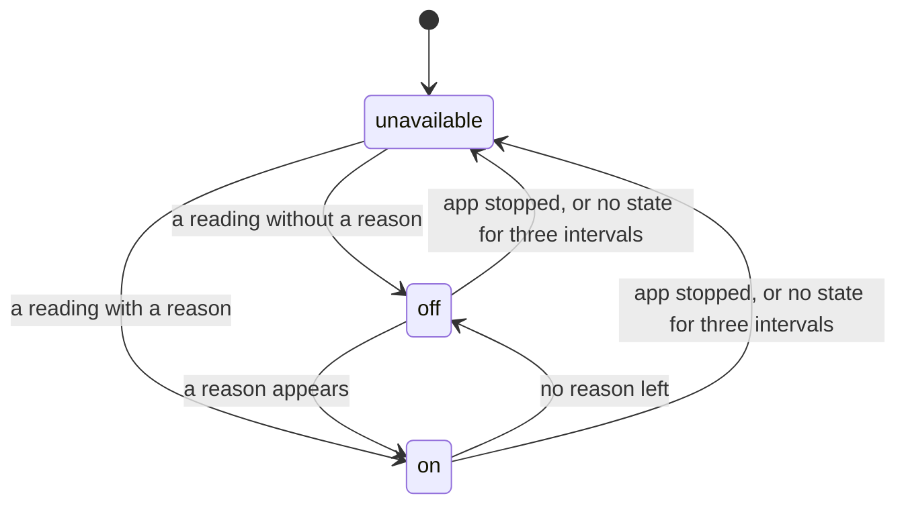

# NVMe Monitor

Reads the SMART log of the host's NVMe drives (`/dev/nvme0` to `/dev/nvme3`) and shows it on a web page: health, wear, temperatures, thermal throttling, data written and how they changed. Home Assistant gets one **Drive problem** sensor per drive through MQTT discovery, for automations and notifications. Nothing is written to the drives or the host.

Requires Home Assistant 2026.11 or later.

## Requirements

- Home Assistant OS on a host with at least one NVMe drive, for example a Raspberry Pi 5 with an NVMe HAT or a PC
- An MQTT broker known to the Supervisor, for example the Mosquitto broker app with the MQTT integration

## Options

| Option | Default | Meaning |
|---|---|---|
| `interval` | `60` | Seconds between two readings of the SMART log (30 to 3600) |
| `discovery_prefix` | `homeassistant` | MQTT discovery prefix |
| `log_level` | `info` | How much the app writes to its log: `info`, `warning` or `error` |

## Web page

Open it with **Open web UI** on the app's page (**Settings → Apps → NVMe Monitor**); to have it in the sidebar as well, turn on **Show in sidebar** there. Only administrators can open it, and it only reads. It speaks the language of your Home Assistant interface (your profile's language: German, else English), follows Home Assistant's theme, light or dark, and updates every 30 seconds. It keeps that language in a cookie for this page only; after you change the language in your profile, the page follows the next time you open it, reloading once. The header shows the app's name and, on wider screens, when the page was read (**As of …**); the round arrow reloads the page, the gear opens the app's settings. At the bottom it shows the app's name and version.

For every drive it shows:

| Card | Content |
|---|---|
| Drive | Whether the drive needs attention and why, model, firmware, capacity, hours powered on, power cycles, controller busy time, data read and written with the number of commands |
| Health | Wear, available spare and its threshold, media errors, error log entries, unsafe shutdowns, the critical warning by name |
| Temperatures | Composite temperature, every temperature sensor the drive has, its warning, critical and throttling thresholds, time above the warning and critical temperature |
| Thermal throttling | Whether the drive throttles from heat now, or only its counters grow (see [Known limitations](#known-limitations)), the counters and times of both stages |
| History | Lowest and highest temperature per hour for 30 days, data written per day for 90 days, and the days on which media errors, error log entries, unsafe shutdowns or wear grew |
| Error log | The entries of the drive's error log, only when it has some |

The drive keeps its counters itself, but no history. The page keeps one in the app's data, for 30 days by the hour and a year by the day, beginning with the first reading. When the app or the host was off for some days, the data written over that time is spread evenly over those days and drawn as lighter bars, and a counter that grew in that time is listed with the whole period.

When a drive cannot be read, the page says since when and keeps showing what the last reading found, error log included. When no reading arrives at all for three intervals, it says that the monitor does not run.

How a reading flows:

```mermaid
sequenceDiagram
    participant D as NVMe drive
    participant M as Monitor
    participant B as MQTT broker
    participant W as Web page
    loop every interval
        M->>D: read the SMART log
        alt readable
            M->>D: read the error log (only when it has entries)
            M->>M: reasons and throttling, compared with the reading before
            M->>B: Drive problem on or off, with the reasons
        else not readable
            M->>M: one warning in the log; the sensor gets no state
        end
        M->>W: status file of the drive
    end
    loop every 15 seconds
        W->>W: take new readings into the history, saved every 5 minutes
    end
```

## Sensors

One device per drive: **Host NVMe** for the first one (`nvme0`), **Host NVMe 1** to **Host NVMe 3** for further ones, each with one entity:

| Entity | Meaning |
|---|---|
| Drive problem | On when the drive needs attention: a critical warning, media errors, the spare at or below the drive's threshold, the rated endurance used up, or thermal throttling the temperatures explain; the `reasons` attribute names them |

The sensor is unavailable when the app stops or dies, and when it gets no state for three intervals, for example while the drive cannot be read or the MQTT broker is away. Unavailable is not "no problem":



## Example automations

Notify when a drive needs attention, with the reasons:

```yaml
triggers:
  - trigger: state
    entity_id: binary_sensor.host_nvme_drive_problem
    from: "off"
    to: "on"
actions:
  - action: notify.notify
    data:
      message: >-
        NVMe drive needs attention:
        {{ state_attr('binary_sensor.host_nvme_drive_problem', 'reasons') | join(', ') }}
```

`from: "off"` keeps a return from unavailable, for example after a restart, from notifying again. The entity IDs follow the device names; adjust them if you renamed a device.

## Troubleshooting

- **The app stops with "No NVMe drive found at /dev/nvme0 to /dev/nvme3".** The host has no NVMe drive, or it is not at `/dev/nvme0` to `/dev/nvme3`. USB enclosures and SATA drives do not provide NVMe SMART data.
- **The app stops with "No MQTT service available".** Install and set up an MQTT broker, for example the Mosquitto broker app with the MQTT integration, then start the app again.
- **The log says "Reading nvme0 failed, retrying every interval".** The drive did not answer. The app keeps trying; the log says when it works again. The web page shows the last values meanwhile.
- **A drive is missing.** The log names each drive it skipped. Drives added while the app runs show up after a restart of the app.
- **The entities are unavailable.** The app is stopped, a drive cannot be read, or the app lost its connection to the MQTT broker; the log tells which.
- **The web page says the monitor does not run.** The page gets no new readings; the app log tells why.

## Known limitations

- Up to four NVMe drives.
- Data written is counted by the drive in units of 512 000 bytes and shown in decimal units (GB, TB).
- Throttling compares two readings, so it shows one interval late.
- Some firmware counts more than thermal throttling in the throttling counters, so they grow at normal temperatures. Throttling therefore counts only when the drive also shows heat: a temperature warning, time above its warning or critical temperature, or a composite temperature at most 10 °C below its lowest threshold in one of the two readings. Without any thresholds from the drive the counters alone count. Counters that grow without heat are no drive problem; the web page says so and shows the raw counters, and the log has one info line per episode.
- The history of the web page starts empty; the drive's counters before it are only shown as totals.
- The app needs the `SYS_ADMIN` capability: the kernel lets only that read the SMART log through the NVMe admin interface. With it, a process in the app could send any command to the drives, so the app keeps it to the monitor. The web page, the only part reachable over the network (through Home Assistant's ingress only), runs as a user of its own without root, without capabilities and without the Supervisor token. An AppArmor profile allows only the capabilities, networks, programs and paths the app uses. Home Assistant lowers the app's security rating for `SYS_ADMIN`.
- The broker's credentials are in configuration files only root in the app can read, not on the command line of the MQTT clients. Every client with access to the broker can still change the states on it, as for any MQTT app; with access control lists on your broker, allow the app's user only `nvme_monitor/#` and `homeassistant/device/nvme_monitor/config`, and the same with `nvme_monitor_nvme1` to `nvme_monitor_nvme3` for further drives.
- The web page shows no serial number.

## Removing the app

The sensors are announced with retained MQTT messages and stay in Home Assistant after the app is removed. Delete the devices **Host NVMe** (and **Host NVMe 1** to **3**) under **Settings → Devices & services → MQTT**; Home Assistant then removes the retained messages as well. The history of the web page goes with the app's data.

## Support

Questions, bugs and ideas: open an issue at https://github.com/n-schilling/ha-app-nvme-monitor/issues. Please add the app version, shown at the bottom of the web page, and the app log.
